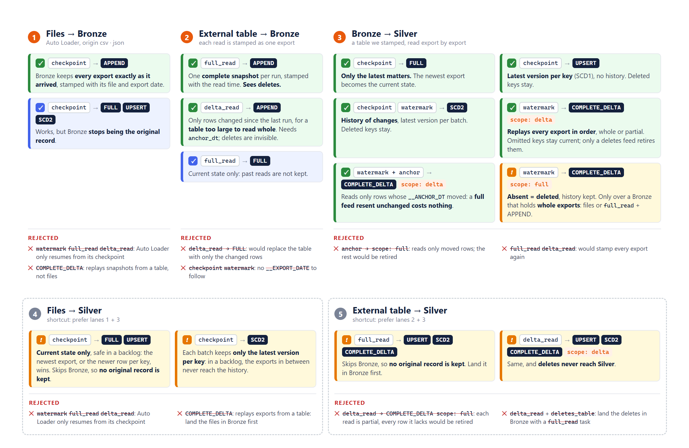

# Examples

## Combinations cheat sheet

One task moves data one hop, for example from Inbound to Bronze. For each hop, the cheat
sheet shows which source (`source.origin`), increment strategy
(`source.increment_strategy`) and write verb (`output.verb`) to combine.

- Each lane is one hop. Read its cards from top to bottom: the first card fits most datasets.
- A green card is recommended. A blue card is possible. An orange card is valid, but read its
  note first.
- The **Rejected** list under each lane shows combinations that the framework refuses. Most
  fail at Start, before the framework reads data.
- Lanes 4 and 5 are shortcuts that skip Bronze, so no original record is kept. Use them only
  when you do not need the original record.

The full page, with a definition of each source, strategy and verb, is in
[combinations.pdf](combinations.pdf). The same rules, with notes, are in the cheat-sheet in
[08_usage.md](../08_usage.md).

## Library-based examples

Complete scenarios that use dbx-flame as a library from PyPI: [library_based](library_based/README.md).
