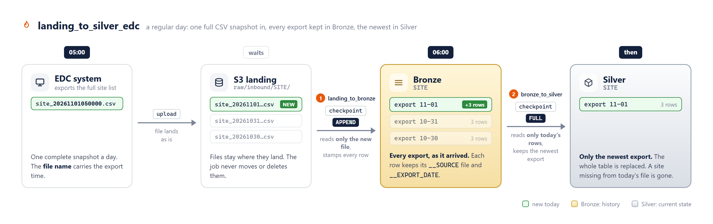

# Example: daily EDC export, from CSV to Silver



## Scenario

- An EDC system exports the full site list one time each day, as one CSV file.
- The file name contains the export time, for example `site_20261101050000.csv`.
- The data has no keys or change dates that you can trust.

## What the job does

The job `landing_to_silver_edc` in [example_edc.yml](example_edc.yml) has two tasks.
Task 2 starts when task 1 is complete.

| Task | Reads | Writes |
|---|---|---|
| 1. `landing_to_bronze_site` | Only the new CSV files in `raw/inbound/SITE/` | APPEND: adds each export to `bronze.SITE` |
| 2. `bronze_to_silver_site` | Only the rows that task 1 added | FULL: replaces `silver.SITE` with the newest export |

The job uses dbx-flame `0.1.0` from PyPI. Do not change the version without a review.

## Try it

1. Create the catalogs, schemas and volumes. Replace `dev` with your bundle target.

   ```sql
   CREATE CATALOG IF NOT EXISTS monitoring_dev;
   CREATE SCHEMA  IF NOT EXISTS monitoring_dev.audit;
   CREATE CATALOG IF NOT EXISTS edc_dev;
   CREATE SCHEMA  IF NOT EXISTS edc_dev.raw;
   CREATE SCHEMA  IF NOT EXISTS edc_dev.metadata;
   CREATE SCHEMA  IF NOT EXISTS edc_dev.bronze;
   CREATE SCHEMA  IF NOT EXISTS edc_dev.silver;
   CREATE VOLUME  IF NOT EXISTS edc_dev.raw.inbound;
   CREATE VOLUME  IF NOT EXISTS edc_dev.metadata.checkpoints;
   ```

   The job user must have access to all of them. See
   [07_workspace_setup.md](../../../07_workspace_setup.md#your-own-pipelines).

2. Copy `example_edc.yml` into your bundle and add it to `include:`.
3. If your workspace is not on AWS, change `node_type_id`.
4. Deploy the bundle:

   ```bash
   databricks bundle deploy -t dev -p <profile>
   ```

5. Make a file with the name `site_20261101050000.csv`:

   ```csv
   SITE_ID,SITE_NAME,STATUS
   S001,Berlin Charite,Active
   S002,Madrid La Paz,Active
   S003,Lyon Sud,Active
   ```

6. Upload the file and run the job. The schedule is paused, so you start the job yourself.

   ```bash
   databricks fs cp site_20261101050000.csv dbfs:/Volumes/edc_dev/raw/inbound/SITE/ -p <profile>
   databricks bundle run landing_to_silver_edc -t dev -p <profile>
   ```

7. Make a second file with a later time, for example `site_20261102050000.csv`. Remove
   `S003` from it. Upload it and run the job again.

## Expected result

After the second run:

| Table | Contents |
|---|---|
| `edc_dev.bronze.SITE` | Both exports, 5 rows (3 + 2). Each row has `__SOURCE` (its file) and `__EXPORT_DATE` (the time in the file name). |
| `edc_dev.silver.SITE` | Only the export of 2026-11-02, 2 rows. `S003` is not in Silver. |
| `monitoring_dev.audit.flame_logs` | One or more rows for each task run. |

```sql
SELECT __EXPORT_DATE, COUNT(*) AS ROW_COUNT FROM edc_dev.bronze.SITE GROUP BY 1 ORDER BY 1 DESC;
SELECT * FROM edc_dev.silver.SITE;
```

If you run the job again without a new file, the tables do not change.
