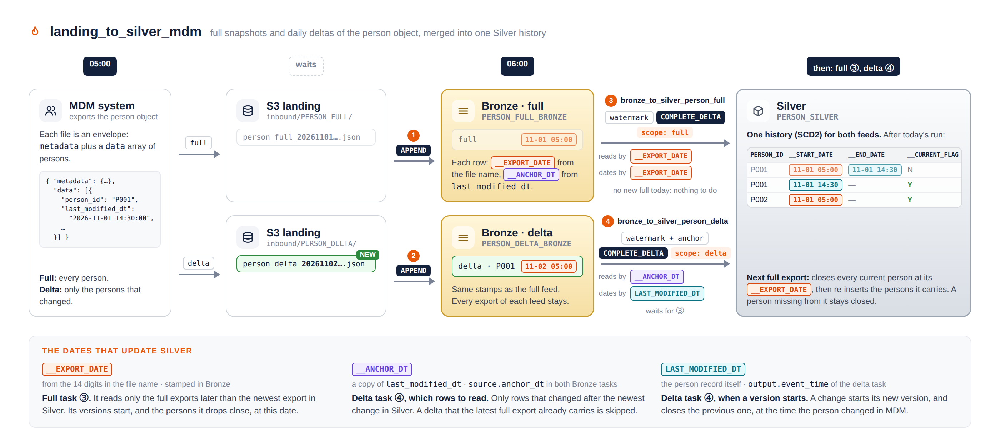

# Example: MDM full and delta exports, from JSON to a Silver history



## Scenario

- An MDM system exports the person object as JSON files.
- It sends two types of export:
  - A **full** export contains all persons.
  - A **delta** export contains only the persons that changed.
- Each file name contains the export time, for example `person_full_20261101050000Z.json`.
- Each person has a key, `person_id`, and a change date, `last_modified_dt`.
- Silver must keep the history of each person (SCD2). The newest full export replaces the current state.

## What the job does

The job `landing_to_silver_mdm` in [example_mdm.yml](example_mdm.yml) has four tasks.

| Task | Reads | Writes |
|---|---|---|
| 1. `landing_to_bronze_person_full` | Only the new files in `raw/inbound/PERSON_FULL/` | APPEND: adds each export to `bronze.PERSON_FULL_BRONZE` |
| 2. `landing_to_bronze_person_delta` | Only the new files in `raw/inbound/PERSON_DELTA/` | APPEND: adds each export to `bronze.PERSON_DELTA_BRONZE` |
| 3. `bronze_to_silver_person_full` | Only the full exports that are newer than Silver | COMPLETE_DELTA, `scope: full`: closes all current persons, then adds the persons of the newest full export |
| 4. `bronze_to_silver_person_delta` | Only the delta rows that changed after the newest change in Silver | COMPLETE_DELTA, `scope: delta`: applies each delta export in date order |

Tasks 1 and 2 run at the same time. Task 3 starts after task 1. Task 4 starts after tasks 2 and 3.

The job uses three dates:

| Date | Comes from | Used by |
|---|---|---|
| `__EXPORT_DATE` | The time in the file name | Task 3: to find the new full exports, and to start and close versions |
| `__ANCHOR_DT` | A copy of `last_modified_dt`, made in Bronze | Task 4: to find the new delta rows |
| `LAST_MODIFIED_DT` | The person record | Task 4: to start and close versions |

The job uses dbx-flame `0.1.0` from PyPI. Do not change the version without a review.

## Try it

1. Create the catalogs, schemas and volumes. Replace `dev` with your bundle target.

   ```sql
   CREATE CATALOG IF NOT EXISTS monitoring_dev;
   CREATE SCHEMA  IF NOT EXISTS monitoring_dev.audit;
   CREATE CATALOG IF NOT EXISTS mdm_dev;
   CREATE SCHEMA  IF NOT EXISTS mdm_dev.raw;
   CREATE SCHEMA  IF NOT EXISTS mdm_dev.metadata;
   CREATE SCHEMA  IF NOT EXISTS mdm_dev.bronze;
   CREATE SCHEMA  IF NOT EXISTS mdm_dev.silver;
   CREATE VOLUME  IF NOT EXISTS mdm_dev.raw.inbound;
   CREATE VOLUME  IF NOT EXISTS mdm_dev.metadata.checkpoints;
   ```

   The job user must have access to all of them. See
   [07_workspace_setup.md](../../../07_workspace_setup.md#your-own-pipelines).

2. Copy `example_mdm.yml` into your bundle and add it to `include:`.
3. If your workspace is not on AWS, change `node_type_id`.
4. Deploy the bundle:

   ```bash
   databricks bundle deploy -t dev -p <profile>
   ```

5. Make a full export with the name `person_full_20261101050000Z.json`:

   ```json
   {
     "metadata": {"export_date": "20261101050000Z"},
     "data": [
       {"person_id": "P001", "name": "Ana Silva", "last_modified_dt": "2026-10-20 09:00:00"},
       {"person_id": "P002", "name": "Ben Okafor", "last_modified_dt": "2026-10-25 11:00:00"},
       {"person_id": "P003", "name": "Chen Wei", "last_modified_dt": "2026-10-28 16:00:00"}
     ]
   }
   ```

6. Make a delta export with the name `person_delta_20261102050000Z.json`:

   ```json
   {
     "metadata": {"export_date": "20261102050000Z"},
     "data": [
       {"person_id": "P001", "name": "Ana Silva-Costa", "last_modified_dt": "2026-11-01 14:30:00"}
     ]
   }
   ```

7. Upload the two files and run the job. The schedule is paused, so you start the job yourself.

   ```bash
   databricks fs cp person_full_20261101050000Z.json dbfs:/Volumes/mdm_dev/raw/inbound/PERSON_FULL/ -p <profile>
   databricks fs cp person_delta_20261102050000Z.json dbfs:/Volumes/mdm_dev/raw/inbound/PERSON_DELTA/ -p <profile>
   databricks bundle run landing_to_silver_mdm -t dev -p <profile>
   ```

8. Make a second full export, `person_full_20261108050000Z.json`. Put `P001` (with the new
   name) and `P002` in it. Do not put `P003` in it. Upload it to `PERSON_FULL/` and run the
   job again.

## Expected result

Use this query to see the history:

```sql
SELECT PERSON_ID, __START_DATE, __END_DATE, __CURRENT_FLAG
FROM mdm_dev.silver.PERSON_SILVER
ORDER BY PERSON_ID, __START_DATE;
```

After the first run (step 7), Silver has 4 rows:

| PERSON_ID | `__START_DATE` | `__END_DATE` | `__CURRENT_FLAG` |
|---|---|---|---|
| P001 | 2026-11-01 05:00 | 2026-11-01 14:30 | N |
| P001 | 2026-11-01 14:30 | | Y |
| P002 | 2026-11-01 05:00 | | Y |
| P003 | 2026-11-01 05:00 | | Y |

After the second run (step 8), Silver has 6 rows. Only `P001` and `P002` are current:

| PERSON_ID | `__START_DATE` | `__END_DATE` | `__CURRENT_FLAG` |
|---|---|---|---|
| P001 | 2026-11-01 05:00 | 2026-11-01 14:30 | N |
| P001 | 2026-11-01 14:30 | 2026-11-08 05:00 | N |
| P001 | 2026-11-08 05:00 | | Y |
| P002 | 2026-11-01 05:00 | 2026-11-08 05:00 | N |
| P002 | 2026-11-08 05:00 | | Y |
| P003 | 2026-11-01 05:00 | 2026-11-08 05:00 | N |

Bronze keeps each export: `PERSON_FULL_BRONZE` has 5 rows (3 + 2) and
`PERSON_DELTA_BRONZE` has 1 row.

If you run the job again without a new file, the tables do not change.
